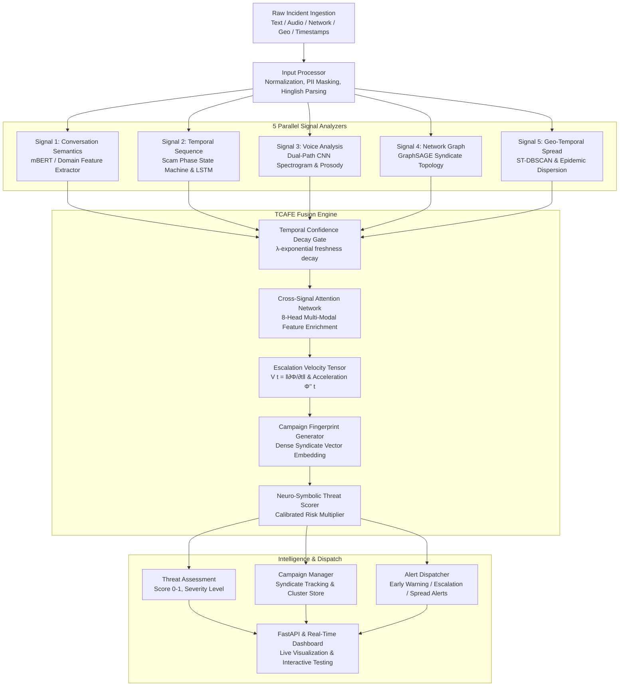

# DASI — Digital Arrest Scam Intelligence System

[](https://www.python.org/)
[](https://fastapi.tiangolo.com/)
[](https://pytorch.org/)
[](LICENSE)
[-brightgreen.svg)]()

An AI-powered, multi-modal threat intelligence system engineered to detect, analyze, and track organized **"digital arrest" scam syndicates** in real time.

Unlike traditional transactional fraud detection systems that trigger alerts only **after** money has already been stolen, DASI introduces a novel **Temporal Confidence-Aware Fusion Engine (TCAFE)** to model the psychological and operational escalation velocity of an attack, delivering **actionable early warnings at Phase 2–3 before financial extraction occurs at Phase 5**.

---

## 📑 Table of Contents

- [The Threat: What is a Digital Arrest Scam?](#-the-threat-what-is-a-digital-arrest-scam)
- [System Architecture & Workflow](#-system-architecture--workflow)
- [Core Innovation: The TCAFE Engine](#-core-innovation-the-tcafe-engine)
- [The 5 Heterogeneous Intelligence Signals](#-the-5-heterogeneous-intelligence-signals)
- [The 5 Canonical Scam Phases](#-the-5-canonical-scam-phases)
- [Key Features](#-key-features)
- [Interactive Visual Dashboard](#-interactive-visual-dashboard)
- [REST API Reference](#-rest-api-reference)
- [Project Directory Structure](#-project-directory-structure)
- [Installation & Quickstart](#-installation--quickstart)
- [Testing & Validation](#-testing--validation)
- [Technology Stack](#-technology-stack)

---

## 🚨 The Threat: What is a Digital Arrest Scam?

In India and Southeast Asia, organized cyber syndicates execute **"digital arrest"** operations by impersonating high-ranking officials from agencies like the **CBI, Mumbai/Delhi Police, Enforcement Directorate (ED), Narcotics Control Bureau (NCB), Telecom Regulatory Authority of India (TRAI), or the Supreme Court**.

Victims are targeted via phone and coerced onto encrypted video calls (WhatsApp, Skype) against forged police backdrops. Scammers claim the victim's Aadhaar or mobile SIM was used in major criminal activity (money laundering under PMLA, drug trafficking, terror funding under UAPA). Under threats of immediate arrest warrants and asset freezes, victims are kept in **isolation for hours or days** until they transfer their life savings into fake *"government RBI verification accounts"*.

### Why Conventional Solutions Fail
* **Banking Anti-Fraud Filters:** Monitor transactions, flagging anomalies only *after* money leaves the account.
* **Telecom Spam Blockers:** Rely on static caller-ID blacklists; easily bypassed with VoIP spoofing and dynamic SIM boxes.
* **Isolated NLP Checkers:** Analyze isolated messages without temporal sequence context or acoustic stress verification.

**DASI solves this** by continuously ingesting multi-channel intelligence during the live attack lifecycle.

---

## 🏗️ System Architecture & Workflow

DASI operates as an asynchronous, modular pipeline where raw incident events pass through normalization, 5 parallel neural analyzers, cross-signal temporal fusion, and syndicate campaign clustering:



### Detailed End-to-End Workflow
1. **Event Ingestion:** An incoming call, chat transcript, network CDR, or audio sample is submitted via REST API or batch ingestion.
2. **Preprocessing & Sanitization:** 
   - Mask sensitive identifiers (`[AADHAAR]`, `[PHONE]`, `[PAN]`).
   - Standardize code-mixed Hinglish transliterations (*e.g., "giraftaar" $\rightarrow$ "arrest", "adalat" $\rightarrow$ "court"*).
3. **Parallel Feature Extraction:** All 5 signal analyzers run independently, producing standardized `SignalOutput` tuples containing high-dimensional embeddings, calibrated confidence scores, timestamps, and metadata.
4. **TCAFE Multi-Modal Fusion:** 
   - Decays older signals based on elapsed time.
   - Computes cross-signal attention to discover reinforcement patterns (*e.g., high authority claim + synthetic voice = amplified risk*).
   - Computes instantaneous escalation velocity $\mathbf{V}(t)$ and acceleration.
5. **Campaign Fingerprinting:** Generates a 128-dimensional fingerprint vector and matches it against active syndicates in the cluster store.
6. **Decision & Alerting:** Dispatches real-time assessments and triggers multi-level alerts (`EARLY_WARNING`, `ESCALATION`, `CAMPAIGN_SPREAD`).

---

## 🌟 Core Innovation: The TCAFE Engine

The central scientific contribution of DASI is the **Temporal Confidence-Aware Fusion Engine (TCAFE)**, composed of 4 mathematically rigorous components:

### 1. Confidence Decay Gate
Different signals have different half-lives. A physical location reading or voice burst ages rapidly, while transcribed legal text remains valid throughout the call:
$$\tilde{c}_i(t) = c_i \cdot \exp\left(-\lambda_i \cdot (t - t_i)\right)$$
Where $\lambda_i$ is a learnable per-signal decay rate and $c_i \in [0, 1]$ is raw reliability.

### 2. Cross-Signal Correlation Attention
Heterogeneous signals are mapped into a unified metric space via an 8-head multi-head cross-attention mechanism:
$$\mathbf{Z}_i = \sum_{j=1}^{M} \alpha_{ij} \mathbf{W}_v \mathbf{e}_j, \quad \alpha_{ij} = \text{softmax}\left(\frac{(\mathbf{W}_q \mathbf{e}_i)(\mathbf{W}_k \mathbf{e}_j)^T}{\sqrt{d_k}}\right) \cdot \tilde{c}_j$$
This allows weak isolated cues across different modalities to reinforce one another into definitive evidence.

### 3. Escalation Velocity Tensor $\mathbf{V}(t)$
Instead of evaluating only static threat magnitude, TCAFE tracks how fast the threat state vector $\mathbf{\Phi}(t)$ changes over time:
$$\mathbf{\Phi}'(t) = \frac{\mathbf{\Phi}(t) - \mathbf{\Phi}(t - \Delta)}{\Delta}, \quad V(t) = \|\mathbf{\Phi}'(t)\|_2$$
When $V(t) > 0.30$, an **Early Warning Alert** triggers before the scam reaches financial extortion.

### 4. Campaign Fingerprinting
Combines fused threat states $\mathbf{\Phi}(t)$ and velocity vectors into a persistent campaign fingerprint:
$$\text{Sim}(\mathbf{f}_a, \mathbf{f}_b) = \frac{\mathbf{f}_a \cdot \mathbf{f}_b}{\|\mathbf{f}_a\| \|\mathbf{f}_b\|}$$
Matches disparate incidents across different phone numbers, states, and victims into unified criminal syndicates.

---

## 📡 The 5 Heterogeneous Intelligence Signals

| Signal | Analyzer | Model Architecture | Core Responsibility |
| :--- | :--- | :--- | :--- |
| **Signal 1: Conversation Semantics** | `ConversationSemanticsAnalyzer` | Multilingual Transformer + 5-Head Extractor | Analyzes text/transcripts across 5 dimensions: Authority Impersonation, Urgency, Isolation, Coercion, and Legal Abuse. |
| **Signal 2: Temporal Sequence** | `TemporalSequenceAnalyzer` | Scam Phase State Machine (SPSM) + 2-Layer LSTM | Detects progression along canonical scam phases ($1 \rightarrow 2 \rightarrow 3 \rightarrow 4 \rightarrow 5$) and transition velocities. |
| **Signal 3: Voice Analysis** | `VoiceAnalyzer` | Dual-Path CNN on Mel-Spectrograms + Prosodic MLP | Detects AI voice cloning/deepfakes, acoustic stress in caller/victim, and call center background noise. |
| **Signal 4: Network Graph** | `NetworkGraphAnalyzer` | GraphSAGE GNN on Communication Topology | Evaluates caller degree, hub-and-spoke dispersion, burner SIM rotation, and mule account clusters. |
| **Signal 5: Geo-Temporal Spread** | `GeoTemporalAnalyzer` | Spatio-Temporal ST-DBSCAN + SIR Epidemic Model | Detects cross-regional scam campaigns propagating across Indian metropolitan zones. |

---

## 📈 The 5 Canonical Scam Phases

DASI models digital arrest attacks as a structured 5-phase psychological escalation:

```
[Phase 1] Authority Claim  ──► [Phase 2] Accusation  ──► [Phase 3] Fear Escalation  ──► [Phase 4] Isolation  ──► [Phase 5] Financial Extraction
   (Threat: 0.28, LOW)            (Threat: 0.47, MED)        (Threat: 0.72, HIGH)          (Threat: 0.85, CRIT)        (Threat: 0.95, CRIT)
                                                             ▲
                                                             │
                                                  ⚠️ EARLY WARNING TRIGGER
                                                  (Velocity crosses 0.30 threshold)
```

1. **Phase 1: Authority Claim (Threat ~0.28, `LOW`):** Scammer introduces themselves as a police officer, CBI inspector, or customs official. No money demanded.
2. **Phase 2: Accusation (Threat ~0.47, `MEDIUM`):** Scammer alleges serious illegal activity (money laundering, narcotic courier, SIM misuse under PMLA).
3. **Phase 3: Fear Escalation (Threat ~0.72, `HIGH`):** **Critical transition point.** Scammer produces forged arrest warrants, court summons, or threats of jail time. **DASI triggers Early Warning here.**
4. **Phase 4: Isolation (Threat ~0.85, `CRITICAL`):** Scammer instructs the victim to remain on video call, imposing secrecy (*"Do not speak to family or lawyers"*).
5. **Phase 5: Financial Extraction (Threat ~0.95, `CRITICAL`):** Demand for money wire/NEFT to a "safe government account" or "RBI verification deposit".

---

## ✨ Key Features

- **Early Warning Detection:** Intervenes at Phase 3 before funds are transferred.
- **Neuro-Symbolic Grounding:** Blends deep learning representations with verified domain terminology for high-precision, low-false-positive detection.
- **Session-Aware Escalation Tracking:** Tracks multi-turn calls accurately without cross-incident derivative bleed.
- **Multi-Level Alerting:** Generates `EARLY_WARNING`, `ESCALATION`, `NEW_CAMPAIGN`, and `CAMPAIGN_SPREAD` alerts.
- **Zero-Fallback Robustness:** Gracefully handles missing signals with automatic sensor imputation so analysis never crashes.
- **Interactive Live AI Tester:** Test presets or custom transcripts in real-time with millisecond inference.
- **Production REST API:** OpenAPI-compliant FastAPI endpoints with WebSocket streaming.

---

## 🖥️ Interactive Visual Dashboard

DASI includes a modern web dashboard ([`dashboard/index.html`](file:///c:/Users/MSI/Desktop/Aditya/Project-1/dashboard/index.html)) designed for operations centers and review panels:

- **Threat Assessment Gauge:** Real-time radial SVG gauge displaying threat score, severity badge, processing time, and confidence.
- **Escalation Velocity Canvas:** Live animated waveform tracking $V(t)$ against the red dashed **Alert Threshold (0.30)** line with dynamic node color changes.
- **5 Signal Sub-Scores:** Visual breakdown of Authority, Urgency, Isolation, Coercion, and Legal Terminology metrics.
- **Cross-Signal Correlation Matrix:** Visual heatmap showing how signals reinforce each other.
- **Live Incident Analyzer (Card 1):** Quick presets (*CBI Digital Arrest*, *ED / PMLA*, *RBI Transfer*, *Legit Telecom*) + custom transcript input box with **`⚡ Analyze with AI`**.
- **Live Event Timeline & Demo Simulation (Card 2):** Automated step-by-step walkthrough of the 5-phase scam attack demonstrating live early warning triggers.

---

## 🔌 REST API Reference

The server exposes standard OpenAPI endpoints on port `8000`:

| Method | Endpoint | Description |
| :--- | :--- | :--- |
| `POST` | `/api/v1/analyze` | Run full 5-signal fusion on a single incident |
| `POST` | `/api/v1/analyze/batch` | Batch process up to 100 incidents concurrently |
| `GET` | `/api/v1/campaigns` | Retrieve all active syndicate campaigns and statistics |
| `GET` | `/api/v1/campaigns/{id}` | Inspect a specific campaign, its members, and threat risk |
| `GET` | `/api/v1/alerts` | List recent early warnings and escalation alerts |
| `GET` | `/api/v1/status` | Real-time system health, signal readiness, and uptime |
| `GET` | `/api/v1/health` | Fast Kubernetes/Docker liveness health check |
| `WS` | `/api/v1/ws/live` | WebSocket connection for streaming live threat events |

### Example Request (`POST /api/v1/analyze`)
```bash
curl -X POST http://localhost:8000/api/v1/analyze \
  -H "Content-Type: application/json" \
  -d '{
    "messages": [
      {
        "role": "caller",
        "text": "Inspector Rajesh Sharma calling from CBI Headquarters. Arrest warrant issued under Section 420.",
        "timestamp_offset": 0
      }
    ],
    "region": "Delhi NCR",
    "caller_id": "+91-9876543210"
  }'
```

### Example Response
```json
{
  "incident_id": "INC-7ACEC2A4",
  "session_id": "SES-91B4C302",
  "timestamp": 1728258898.0,
  "threat": {
    "threat_score": 0.7692,
    "threat_level": "HIGH",
    "escalation_speed": 0.0,
    "escalation_trend": "STABLE",
    "escalation_alert": "NONE",
    "campaign_id": 0,
    "is_new_campaign": false,
    "campaign_risk": 0.54,
    "signal_contributions": {
      "conversation_semantics": 0.38,
      "temporal_sequence": 0.21,
      "voice_analysis": 0.15,
      "network_graph": 0.14,
      "geo_temporal": 0.12
    },
    "processing_time_ms": 58.2
  },
  "signals_available": [
    "conversation_semantics",
    "temporal_sequence",
    "voice_analysis",
    "network_graph",
    "geo_temporal"
  ],
  "signals_missing": []
}
```

---

## 📂 Project Directory Structure

```text
Project-1/
├── src/
│   ├── signals/                       # 5 Heterogeneous Signal Analyzers
│   │   ├── base_signal.py             # Base SignalOutput contract & serialization
│   │   ├── conversation_semantics/    # Signal 1: NLP Transformer & scam feature extractor
│   │   ├── temporal_sequence/         # Signal 2: Scam Phase State Machine & LSTM
│   │   ├── voice_analysis/            # Signal 3: Mel-spectrogram CNN & prosodic analyzer
│   │   ├── network_graph/             # Signal 4: GraphSAGE syndicate topology analyzer
│   │   └── geo_temporal/              # Signal 5: Spatio-temporal ST-DBSCAN clustering
│   ├── fusion/                        # TCAFE Fusion Engine (★ Core Innovation)
│   │   ├── tcafe.py                   # Master fusion coordinator & threat scorer
│   │   ├── confidence_decay.py        # Temporal confidence decay gate
│   │   ├── cross_attention.py         # 8-head cross-signal multi-modal attention
│   │   ├── escalation_velocity.py     # Escalation velocity tensor & acceleration
│   │   └── campaign_fingerprint.py    # Syndicate fingerprint generator
│   ├── pipeline/                      # Orchestration & Ingestion
│   │   ├── orchestrator.py            # Master pipeline runner
│   │   └── input_processor.py         # Input validation, PII masking, Hinglish cleaning
│   ├── campaign/                      # Syndicate Campaign Intelligence
│   │   ├── campaign_manager.py        # Campaign assignment & lifecycle tracking
│   │   ├── alert_engine.py            # Multi-level alert generator
│   │   └── campaign_store.py          # Persistent campaign state store
│   ├── api/                           # REST API (FastAPI)
│   │   ├── app.py                     # App factory, CORS, exception handling, lifespan
│   │   ├── routes.py                  # API routes (/analyze, /campaigns, /alerts, etc.)
│   │   └── schemas.py                 # Pydantic request/response models
│   ├── data/                          # Synthetic Data Generators
│   │   ├── dataset_generator.py       # Master dataset synthesizer
│   │   ├── text_generator.py          # Multilingual Hinglish scam transcript generator
│   │   ├── audio_generator.py         # Acoustic feature & synthetic voice synthesizer
│   │   ├── network_generator.py       # Graph topology synthesizer
│   │   └── geo_generator.py           # Indian regional geo-temporal synthesizer
│   ├── training/                      # Training Engine & Loss Functions
│   │   ├── trainer.py                 # Unified model trainer
│   │   └── losses.py                  # Custom fusion loss functions
│   └── evaluation/                    # Evaluation & Benchmarking
│       ├── evaluator.py               # Multi-metric evaluator
│       └── benchmark.py               # End-to-end benchmark suite
├── dashboard/                         # Visual Operations Dashboard
│   ├── index.html                     # Responsive UI layout
│   ├── styles/dashboard.css           # Premium dark-mode glassmorphic styles
│   └── scripts/dashboard.js           # Interactive state manager, animations & charts
├── config/                            # YAML Configuration
│   ├── model_config.yaml              # Hyperparameters, dimensions, decay rates
│   └── system_config.yaml             # API, logging, and execution configs
├── tests/                             # Unit & Integration Test Suite
│   ├── test_api.py                    # REST endpoint tests
│   ├── test_pipeline.py               # Orchestrator & InputProcessor tests
│   ├── test_fusion.py                 # TCAFE engine & component tests
│   ├── test_signals.py                # All 5 signal analyzer unit tests
│   └── test_campaign.py               # Campaign manager & alert tests
├── train.py                           # Training CLI entrypoint
├── requirements.txt                   # Production Python dependencies
└── README.md                          # Documentation & system guide
```

---

## 🚀 Installation & Quickstart

### 1. Prerequisites
- **Python:** 3.10, 3.11, 3.12, or 3.13
- **Operating System:** Windows, macOS, or Linux
- **RAM:** Minimum 4 GB (8 GB recommended)

### 2. Install Dependencies
```powershell
pip install -r requirements.txt
```

### 3. Launch the API Server
```powershell
uvicorn src.api.app:app --reload --host 0.0.0.0 --port 8000
```
The server will start at `http://localhost:8000`. You can access interactive Swagger API documentation at:
👉 **`http://localhost:8000/docs`**

### 4. Open the Visual Dashboard
Double-click [`dashboard/index.html`](file:///c:/Users/MSI/Desktop/Aditya/Project-1/dashboard/index.html) or open it in your browser.
- Verify the top badge displays `⚡ FastAPI Live`.
- Click **"▶ Run Demo Simulation"** to watch the animated 5-phase scam progression.
- Test custom messages using the **"Live Incident Analyzer"**.

---

## 🧪 Testing & Validation

Run the comprehensive automated test suite:

```powershell
pytest tests/ -v
```

### Test Coverage Highlights
- **`tests/test_api.py`:** Verifies all 6 REST endpoints (`/health`, `/status`, `/campaigns`, `/alerts`, `/analyze`, `/analyze/batch`).
- **`tests/test_pipeline.py`:** Validates input sanitization, PII masking, Hinglish normalization, and zero-failure fallback.
- **`tests/test_fusion.py`:** Validates Confidence Decay Gates, Cross-Signal Attention matrices, Escalation Velocity tensors, and Campaign Fingerprints.
- **`tests/test_signals.py`:** Tests each of the 5 signal analyzers independently.
- **`tests/test_campaign.py`:** Validates cluster matching, lifetime tracking, and alert dispatching.

---

## 🧰 Technology Stack

| Layer | Technologies |
| :--- | :--- |
| **Machine Learning Core** | PyTorch 2.x, Torch Geometric, HuggingFace Transformers |
| **Natural Language Processing** | Multilingual BERT (`mBERT`), Hinglish phonetic normalizer |
| **Audio Processing** | Librosa, torchaudio, Acoustic MFCC/Chroma feature extractors |
| **Graph Neural Networks** | PyTorch Geometric, GraphSAGE inductive graph embeddings |
| **Spatial & Clustering** | ST-DBSCAN, HDBSCAN, Scikit-learn, Haversine geospatial metrics |
| **REST API Server** | FastAPI, Starlette, Uvicorn (ASGI), Pydantic v2 |
| **Operations Dashboard** | Vanilla HTML5, CSS3 Glassmorphism, Canvas API, JavaScript (ES6+) |
| **Testing & Quality** | Pytest, AnyIO, Python Logging |

---

*Developed for Advanced Cyber Threat Intelligence & Scam Campaign Detection — 2026*
